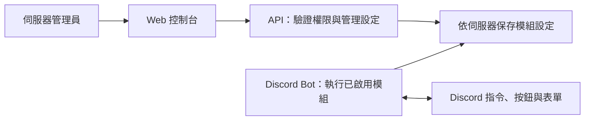

# Potato Bot｜Discord 社群自動化與管理平台

Potato Bot 讓管理員在 Web 控制台設定歡迎訊息、身分組、票口及審核流程。社群成員可直接在 Discord 使用指令、按鈕、選單與表單。系統以 TypeScript 開發，控制台、API 與 Bot 分工，依伺服器驗證操作權限。

## 產品網站

- **[Potato Bot 官方網站](https://bot.sofapotatoes.com/)**：產品網站入口。
- 此連結是產品網站，**不代表所有後台功能都能免登入操作**。實際可試用範圍依網站公開頁面及 Discord 授權條件而定。

## 系統架構

## 已發布功能

- **功能創建器**讓管理員以起點、條件與動作節點組合流程，支援發布前試跑及版本還原。
- **訊息模板**支援 Discord Components V2 訊息設計、排程發送及版本比較。常用公告可存成模板，供多個功能重複使用。
- **身分組連動**支援連動、互斥、前提與衝突規則。管理員可先試算調整結果，再套用規則。
- **違規案件**讓管理員追蹤警告、點數、有效期限與處置紀錄。

## AI 功能｜上線驗收中

驗收涵蓋兩條流程：**可疑訊息判讀與人工複核**，以及**伺服器結構規劃與權限檢查**。AI 產出供管理員判讀的風險線索或變更草稿。管理員在案件介面決定後續處置，在結構管理介面確認計畫後另行執行。

### AI 防詐與案件審核

1. **受理訊息。** 成員可從 Discord 訊息選單回報可疑內容。啟用條件式分析的伺服器，也可將符合條件的候選訊息送交判讀。
2. **產出風險分類。** 本機模型可處理文字與符合條件的圖片。模型逾時或無法判讀時，流程保留未知結果，讓管理員核對原始脈絡。
3. **由管理員複核。** 案件保留審核所需的最小訊息參照與分類結果。管理員可確認可疑、標記誤判，並依社群規則決定後續處置。AI 分類本身不會觸發處罰。

### AI 伺服器結構管理

| 操作 | 系統產出 | 管理員如何使用 |
| --- | --- | --- |
| **AI 建立** | 依描述產生分類、頻道與身分組配置草稿 | 編輯名稱、排序及項目，與現有結構比對後加入變更計畫 |
| **AI 指令** | 將自然語言轉成可預覽的變更草稿，或回傳純查詢結果 | 先看每項變更的前後值，再儲存計畫並另行執行。純查詢可用來找出需要檢查的頻道或身分組 |
| **權限健檢** | 以規則找出值得檢查的權限，再由 AI 提供解說 | 核對開放發言或權限繼承是否符合社群需求，再選擇要加入計畫的調整 |

執行時會重新確認操作者與 Bot 的權限，並比對 Discord 現況。如果目標在計畫儲存後已被修改，衝突項目會跳過，避免覆蓋後續變更。執行結果不明時，管理員可先在 Discord 核對結果。模型不可用時，仍可使用手動編輯及既有範本。

### 控制台與資料處理

- **AI 總覽**提供模型連線狀態與模組用量，方便區分模型不可用、用量限制與需要人工複核的情況。
- **資料最小化**依工作流程決定模型可用的資訊。結構規劃以本機模型處理描述及所需的結構設定，不讀取聊天或成員名單。
- **自願提供樣本**由使用者主動勾選，保存前去識別化，並提供查閱與刪除。Discord 訊息判讀與結構規劃的樣本提供是各自獨立的流程。

### 驗收情境

| 情境 | 預期行為 |
| --- | --- |
| 用虛構文字與圖片提交可疑訊息 | 產生可複核的風險線索，管理員可確認或標記誤判 |
| 模型逾時、離線或未能判讀 | 顯示未知或不可用狀態，保留人工複核或手動編輯路徑 |
| 管理員以文字要求調整公告區設定 | 顯示草稿與前後值，待管理員另行確認才執行 |
| 計畫儲存後，目標或操作者權限已變動 | 擋下未授權操作，跳過有衝突的變更並呈現結果 |

## 其他待驗收功能

成員名單搜尋與大型票口附件分卷已記錄於開發更新，正式部署狀態待確認。

## 技術取捨與展示情境

儲存設定、啟用模組和發布訊息分開操作，讓管理員有機會預覽、修正與比較版本，再將變更套用到伺服器。

以虛構的 Discord 伺服器示範一則活動公告。先建立模板並預覽，再比較修改前後的版本，最後設定發送時間。功能創建器可用一條活動查詢指令示範試跑，檢查不同條件下的回覆。

[回到作品集](../../README.md)
