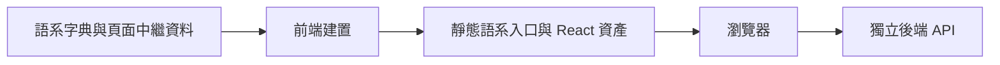

# SofaPotatoes Web｜多語系網站與靜態 SEO

官網以 React 建置，由靜態網站交付前端頁面，帳號與服務資料由獨立 API 提供。繁體中文是預設語系，前端也提供英文、簡體中文與日文介面。

[瀏覽 SofaPotatoes 官網](https://network.sofapotatoes.com/)

## 系統架構

## 技術取捨

- **多語系與 SEO 共用資料來源。** 建置時輸出語系 HTML 入口，讓頁面初始的語言、標題與 canonical 能和前端導覽對應。翻譯尚未補齊的文字以繁中回退。
- **自動驗證交付版本。** 建置、翻譯檢查與測試納入 CI。部署核對通過檢查的提交，再以健康檢查確認交付結果。
- **兼顧前端效果與載入條件。** 首頁 WebGL 視覺設計支援降低動態效果，並提供靜態圖片作為繪圖無法使用時的備援。

## 展示情境

以公開頁面為例，切換語系後重新整理，再使用瀏覽器上一頁與下一頁。檢查頁面語言是否與網址一致，以及靜態 HTML 中的標題、語言與 canonical 是否符合該入口。另可開啟系統的降低動態效果設定，檢查首頁視覺是否仍可閱讀。

[回到作品集](../../README.md)
