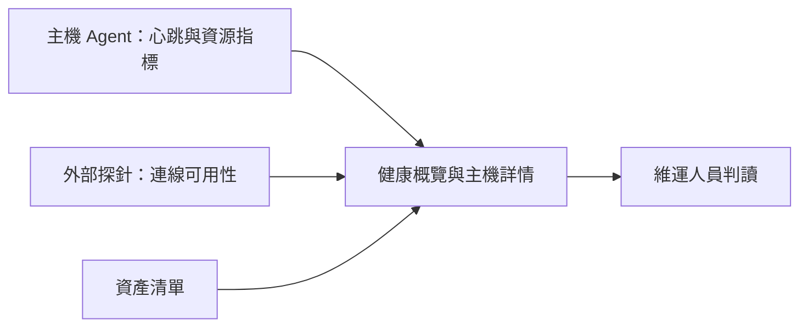

# War Room｜主機監控戰情室

War Room 把主機健康、資源負載和異常事件集中在同一個介面。維運人員可以先看整體狀況，再進入主機詳情核對指標與告警原因。

## 系統架構

## 技術取捨

- **分開呈現 Agent 心跳與外部探針。** 主機停止回報時，外部連線結果可提供另一個線索，幫助維運人員縮小排查範圍。
- **以監控檢查銜接主機納管。** 建立資產後，核對心跳、資源指標與外部可用性，再判斷主機是否已達交付條件。
- **從總覽進入詳情。** 總覽顯示健康與負載分布，詳情提供單台主機的指標、告警與歷史趨勢。

## 示範資料

以下為虛構遙測，可用來說明同一種告警訊號在不同情境下如何判讀。

| 主機 | Agent 心跳 | 外部探針 | 判讀方向 |
| --- | --- | --- | --- |
| Demo A | 正常 | 正常 | 兩種訊號都正常 |
| Demo B | 逾時 | 可達 | 優先檢查 Agent 與回報鏈路 |
| Demo C | 正常 | 失敗 | 優先檢查外部服務與連線路徑 |

[回到作品集](../../README.md)
